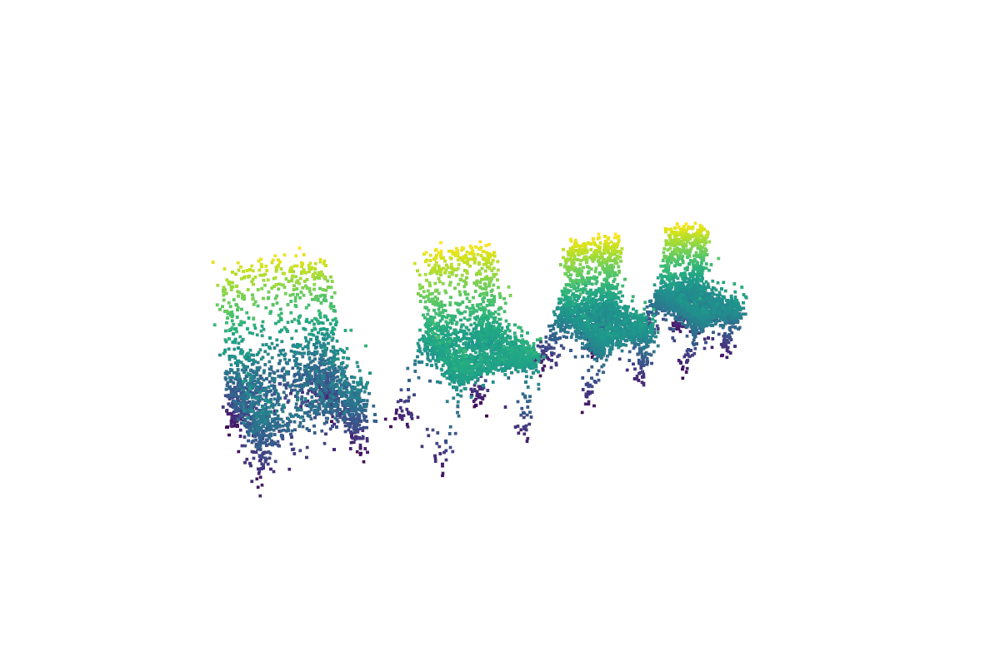
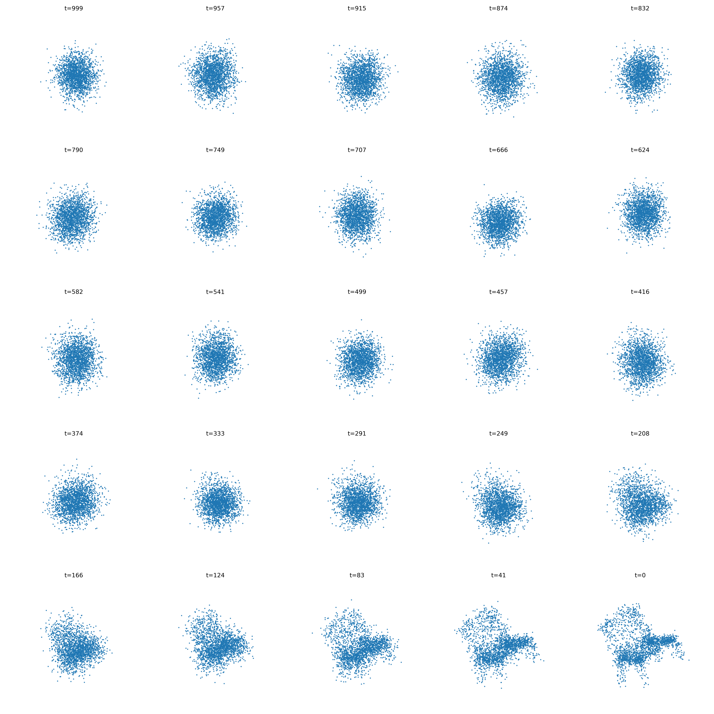

  <h1>👋 Hi, I'm Erfan Radfar</h1>
  
<strong>MPhil student in Electronic & Computer Engineering at HKUST</strong>

  
Mechanical Engineering graduate from Sharif University of Technology

  
🤖 Robotics · Intelligent Control · Representation Learning · Haptics · Deep RL

  

    
    
    
  

---

## About me

<table>
  <tr>
    <td align="center" width="33%"><h3>🏆 Recognition</h3>
Gold medalist, National Olympiad of Mechanical Engineering (2023–2024)
</td>
    <td align="center" width="33%"><h3>📚 Research</h3>
Published in Springer Nature's HSSC and IEEE ICROM 2024; recipient of a Best Paper Award
</td>
    <td align="center" width="33%"><h3>🎓 Education</h3>
Top-ranked B.Sc. graduate in Mechanical Engineering
</td>
  </tr>
</table>

My interests span machine learning, intelligent systems, robotics, reinforcement learning, and signal processing. I enjoy building systems that connect learning algorithms with real-world robotic platforms.

## Research interests

`Robotics` · `Intelligent control` · `Deep reinforcement learning` · `Haptics` · `Representation learning` · `Sensor fusion`

## Selected projects

### 🌐 3D point-cloud generation · Fall 2025

A denoising diffusion model for 3D point clouds, paired with a simplified PointNet-style architecture.

<table>
  <tr>
    <td align="center" width="50%"><strong>Generated point clouds</strong> </td>
    <td align="center" width="50%"><strong>Denoising process</strong> </td>
  </tr>
</table>

### ✋ Dexterous robotic grasping with reinforcement learning · Spring 2025

This project studies deep reinforcement learning for a robotic arm with a five-fingered hand. The policy was evaluated on boxes, spheres, cylinders, and cups in different sizes, then tested on eight unseen objects to assess generalization.

**Grasping demonstration**

### 🚁 Multirotor design, control & obstacle-aware path planning · Summer 2024

Cascaded PID control and path planning for a multirotor in Simulink.

  

## Skills

| Area | Tools and technologies |
| --- | --- |
| Programming | Python, MATLAB, C, C++ |
| Robotics | ROS 2, MuJoCo, Gazebo |
| Simulation | Simulink, MATLAB, Proteus |
| Hardware | Arduino, embedded systems |
| CAD | SolidWorks, CATIA |

## More projects

- Intelligent control of a dexterous robotic hand using deep reinforcement learning
- Multirotor path planning and control in Simulink
- Brushless DC motor control with Arduino
- PID and classical controller design for dynamic systems
- Physics-informed AI for sensor fusion and navigation

## Get in touch

  <a href="mailto:erfanradfar200117@gmail.com">📧 Personal email</a> ·
  <a href="mailto:eradfar@connect.ust.hk">📧 HKUST email</a> ·
  <a href="https://www.linkedin.com/in/erfan-radfar-703912266">LinkedIn</a> ·
  <a href="https://scholar.google.com/citations?hl=en&user=qGLV1IMAAAAJ">Google Scholar</a>
  
<strong>Open to research collaborations and new ideas.</strong>

